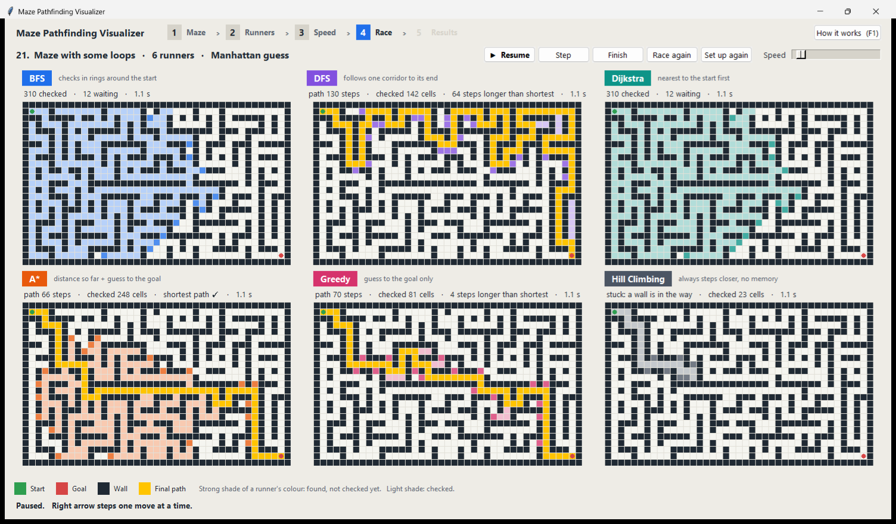
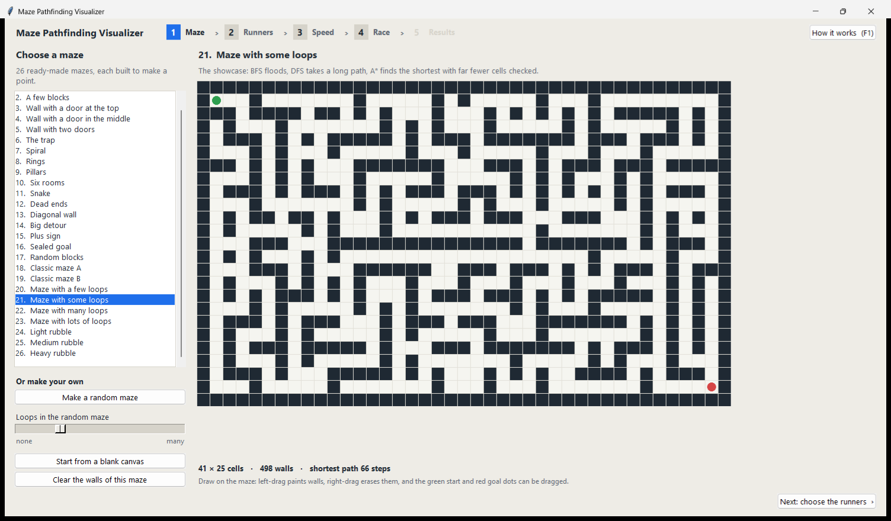
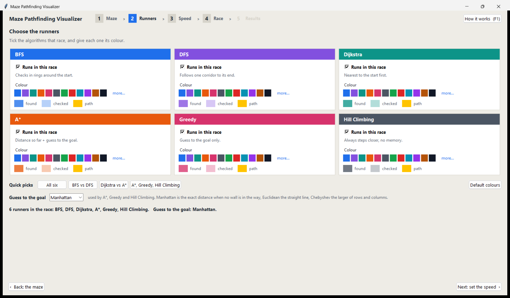
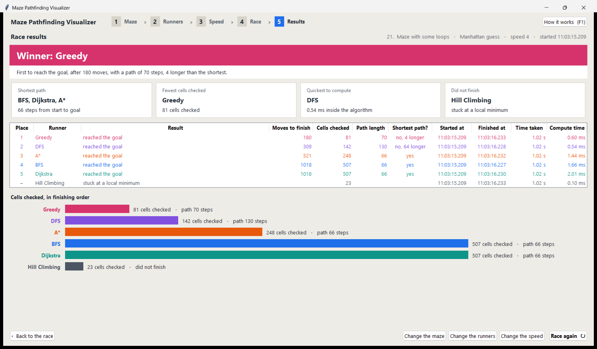

# Maze Pathfinding Visualizer

[](https://github.com/brishabkc24/maze-pathfinding-visualizer/actions/workflows/tests.yml)


[](https://github.com/brishabkc24/maze-pathfinding-visualizer/releases/latest)

Watch BFS, DFS, Dijkstra, A\*, Greedy best-first and Hill Climbing solve the
same maze side by side, each in its own colour, and find out who won. Made for
showing search algorithms to a class: five screens that read like an app,
plain words everywhere, and a "How it works" window that explains the rest.
Python with Tkinter and nothing else: no numpy, no pip install, just
`python app.py`.



## Five screens

1. **Maze.** 26 ready-made mazes, each built to make a point: Empty room,
   Wall with a door at the top, The trap, Spiral, Dead ends, Big detour,
   Sealed goal, Classic maze, Maze with some loops, Heavy rubble and more. The
   note above the preview says what to look for. Or make a random maze with as
   many loops as you like, or start from a blank canvas and draw your own:
   left-drag paints walls, right-drag erases them, and the green start and red
   goal dots can be dragged.
2. **Runners.** One card per algorithm: tick it to race, and pick its colour
   from the chips or from the full colour dialog. Quick picks set up common
   comparisons such as *BFS vs DFS* or *Dijkstra vs A\**. The *Guess to the
   goal* box picks the heuristic that A\*, Greedy and Hill Climbing use:
   Manhattan, Euclidean or Chebyshev. All three keep A\* on the shortest path;
   Manhattan is the closest guess on a grid, so A\* checks the fewest cells
   with it.
3. **Speed.** Slow, Normal, Fast or Very fast, or a fine slider: how many
   moves every runner makes per tick, where a move is one look at one cell. A
   countdown from 3 and *Big text* for a projector live here too.
4. **Race.** Every runner solves the same maze at the same time in its own
   panel, with live counters. Pause, Step one move at a time, Finish, change
   the speed, race again, or go back and change the setup.
5. **Results.** The winner, three more awards (shortest path, fewest cells
   checked, quickest to compute), the runners that did not finish, a table
   with every number and clock time, and a chart of the cells each runner
   checked.

| Maze | Runners |
| --- | --- |
|  |  |



## Who wins

Every runner makes the same number of moves per tick, so the race is fair. A
move is one look at one cell: finding a new cell (adding it to the frontier)
or checking one (taking it off). The **winner** is the runner that reaches the
goal in the fewest moves. That is often not the runner with the best path,
which is the point: three more awards go to the **shortest path** (compared
with the BFS path), the **fewest cells checked** and the **quickest to
compute** (time spent inside the algorithm itself, without the drawing). A
runner that never reaches the goal **did not finish**: Hill Climbing when a
wall is in its way, or everyone when the goal is sealed.

On maze 21, *Maze with some loops* (41×25, 15 % of its inner walls removed),
with the Manhattan guess, one race gave:

| Place | Runner | Moves to finish | Cells checked | Path length | Shortest path? |
| --- | --- | ---: | ---: | ---: | --- |
| 1 | Greedy | 180 | 81 | 70 | no, 4 longer |
| 2 | DFS | 309 | 142 | 130 | no, 64 longer |
| 3 | A\* | 521 | 248 | 66 | yes |
| 4 | BFS | 1018 | 507 | 66 | yes |
| 5 | Dijkstra | 1018 | 507 | 66 | yes |
| – | Hill Climbing | stuck at a local minimum | 23 | | |

Greedy wins the race and pays for it with a slightly longer path. DFS is
second and takes twice the path. A\* is the first runner home with a shortest
path, checking half as many cells as BFS and Dijkstra, which flood half the
maze but are always optimal. Hill Climbing, which has no memory of where else
it could go, walks until a wall is between it and the goal and stops there.

## Run it

**Windows, no Python needed:** download `MazePathfindingVisualizer.exe` from
the [latest release](https://github.com/brishabkc24/maze-pathfinding-visualizer/releases/latest)
and double-click it. The first launch takes a few seconds while Windows unpacks
it, and SmartScreen may warn because the file is not signed: choose "More
info", then "Run anyway".

**From source:** Python 3.10 or newer with Tkinter (included with the standard
installers on Windows and macOS; on Debian/Ubuntu install `python3-tk`). No
other dependencies.

```bash
git clone https://github.com/brishabkc24/maze-pathfinding-visualizer.git
cd maze-pathfinding-visualizer
python app.py
```

**Build the exe yourself:** install PyInstaller with
`pip install -r requirements-build.txt`, then run
`python -m PyInstaller MazePathfindingVisualizer.spec --noconfirm --clean`;
the file appears in `dist/`. GitHub Actions runs the same build on every push,
and pushing an annotated tag such as `v1.2` publishes a release with the exe
attached and the tag's message as the release notes, so write the notes in the
tag: `git tag -a v1.2 -m "..."`.

## How it works

- `grid.py` is the model: a list-of-lists of open and wall cells plus the
  start and goal, with no Tkinter in it.
- `algorithms.py` holds the six searches as plain Python generators. Each one
  yields `("discover", cell)` when it adds a cell to its frontier,
  `("visit", cell)` when it expands one, and finally `("done", path)`.
  Dijkstra, A\* and Greedy are one best-first engine with different weights
  on distance-so-far and the heuristic. Hill Climbing is steepest ascent with
  no backtracking, which is why it can get stuck.
- `race.py` advances every chosen generator by the same number of events per
  tick (one event, a cell found or a cell checked, is what the app calls a
  move), so the panels stay in lockstep, and records for each one the cells
  explored, the path, the clock times it started and finished, and the time
  spent inside the generator. When everyone is done, `Race.results()` ranks
  the finishers and hands out the awards.
- `maze_gen.py` carves a perfect maze by recursive backtracking and then
  *braids* it by removing a fraction of the walls between corridors.
  `templates.py` is the catalogue of ready-made mazes.
- `app.py` is the five screens. The settings live on the `App`; each screen
  reads them when it is shown, and changing a setting discards the race so
  that every race is a fair one. The panels draw one rectangle per cell
  **once** and only recolor them afterwards. Nothing is deleted and redrawn,
  which is what keeps the canvas smooth with six panels animating at once.

## Tests

```bash
python -m pytest
```

The suite checks, over many seeded mazes, that BFS, Dijkstra and A\* agree on
the shortest length, that every path is contiguous and open, that DFS and
Greedy are never shorter than BFS, that A\* never explores more than
Dijkstra, that all three heuristics keep A\* optimal, that the generators
leave the grid untouched, that the maze generator produces a spanning tree and
braiding only removes walls, that every template is solvable (except the one
meant not to be), and that the race runner keeps the algorithms in lockstep,
records their times and names the right winner.

## License

[MIT](LICENSE)
